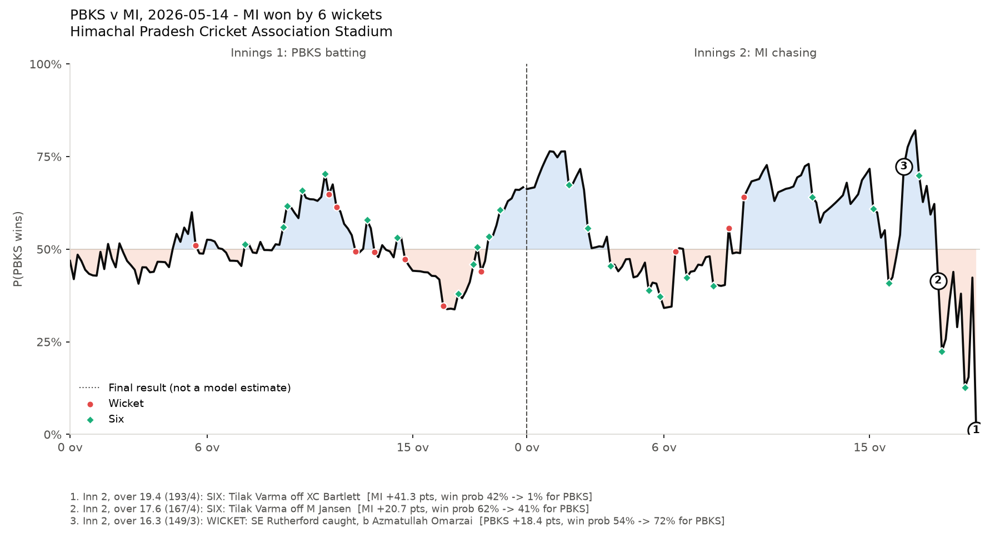
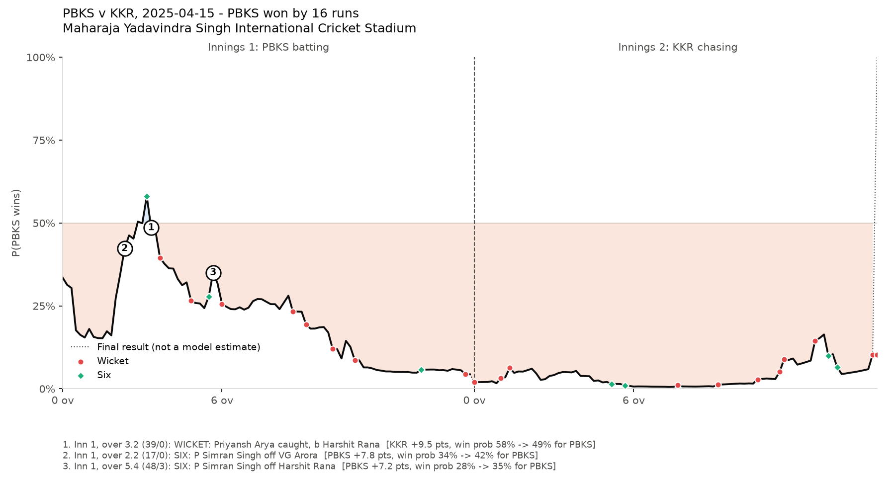
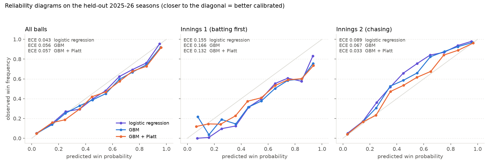

# IPL ball-by-ball win probability

A live win-probability model for the IPL, in the spirit of the win predictor shown during broadcasts, built to be **honestly evaluated**: it is trained on past seasons, tuned on 2024, and scored on the two seasons it was not trained on (2025 and 2026). **Read the "Test-set reuse" section before the results: the test seasons were scored in three versions of the pipeline, so they are a good but not a perfectly clean holdout.** The question is not "what is the accuracy" but "when the model says 70%, do teams win 70% of the time, and does that hold up on future seasons?"

**Match replay demo:** `demo/index.html` is a single self-contained HTML file. GitHub shows it as source code, so clone or download the repo and double-click it (no server needed). Pick any of the 138 held-out matches to see the win-probability line ball by ball, with wickets and sixes marked and the three biggest turning points annotated.



*PBKS v MI, 14 May 2026 (a held-out season the model was never trained on). The lead changed hands repeatedly; Tilak Varma's sixes at 17.6 and 19.4 swung it to MI, who won by 6 wickets. The dotted final step is the actual result, not a model estimate.*



*An upset, PBKS v KKR, 15 April 2025. Defending 111, PBKS were given under 10% for almost the whole chase, a fair reading of such a low total; KKR were then bowled out for 95. A calibrated model still loses matches like this: a 5% chance should come true about 1 time in 20.*

## What was built

| Piece | Where |
|---|---|
| Data pipeline (Cricsheet ball-by-ball to one row per legal delivery) | `src/build_dataset.py` |
| Model selection on past seasons only (backtests, ablations, tuning) | `src/run_validation.py` |
| The one-off test on 2025-26, with bootstrap confidence intervals | `src/final_test.py` |
| Turning-point detection and replay data | `src/turning_points.py`, `src/make_replay.py` |
| Static HTML replay | `demo/index.html` |
| Evaluation notebook (executed, with charts) | `notebooks/evaluation.ipynb` |
| Every decision, with the numbers behind it | `DECISIONS.md` |

## Data

Ball-by-ball and match data for all IPL matches from [Cricsheet](https://cricsheet.org/) (Open Data Commons Attribution License, ODC-By; please credit Cricsheet if you reuse anything here). 1,243 matches from 2008 to 2026.

Matches that cannot be fairly labelled by "who won the chase" were excluded and counted:

| Reason | Matches |
|---|---|
| Duckworth-Lewis / rain-revised target | 23 |
| Tie decided by a super over | 16 |
| Other reduced-overs matches | 11 |
| No result | 8 |
| First innings cut short | 3 |
| **Kept** | **1,182** (273,644 legal deliveries) |

Note that ties and no-results are excluded, so the test set omits the very closest finishes (super-over matches) and the results below are for matches decided in 20 overs.

Ball labels such as "15.1" follow Cricsheet's convention: completed overs, then the ball within the next over (so 15.1 is the first ball of the 16th over, and 19.6 the last ball of the match).

Splits are by season, never by ball:

| Split | Seasons | Matches | Deliveries |
|---|---|---|---|
| Train | 2008-2023 | 974 | 225,926 |
| Validation (tuning, calibration) | 2024 | 70 | 16,107 |
| **Test** | 2025-2026 | 138 | 31,611 |

2026 is a complete season in the data (70 of its 74 matches kept; 4 excluded as no-result / tie / reduced-overs / D/L).

## Method in one page

* **State before the ball.** Each row is the situation just before a legal delivery: runs, wickets, balls left, smoothed run rate and, in the chase, the target, runs required and required run rate. The label is whether the team batting in that innings goes on to win.
* **One model per innings.** The questions are different (an open-ended projection versus a chase with a target) and separate models beat a joint model with an innings flag on every backtest fold (log loss 0.534 vs 0.544).
* **Baseline:** logistic regression on a handful of raw features. **Main model:** LightGBM with shallow trees, boosted *from* the logistic-regression logit, plus the ground's historical scoring level. Hyper-parameters were chosen on rolling-origin backtests over 2021-2024.
* **Metrics:** log loss and Brier score (both reward honest probabilities), ROC-AUC, expected calibration error (ECE) and reliability diagrams, overall and by innings and phase. Confidence intervals come from resampling whole matches, since the balls of one match are not independent.

## Test-set reuse (please read first)

The 2025-26 seasons were scored in **three versions** of the pipeline, not once:

1. First full run. Log loss: logistic regression 0.5518, GBM 0.5521.
2. After I fixed an unstable run-rate feature (a first-ball six made "projected score" explode) with a shrinkage prior. LR 0.5465, GBM 0.5488.
3. After I changed that prior from a constant to the recent league scoring rate. **LR 0.5405, GBM 0.5463** (final, reported below).

What that means:

* **Pre-declared (before seeing any test number):** the headline was the *raw* GBM, with the logistic regression as baseline. Pre-test nested backtests showed post-hoc calibration *hurting* (log loss raw 0.531, Platt 0.553, isotonic 0.585).
* **Chosen after seeing test results:** the run-rate prior (versions 2 and 3), the decision to adopt Platt scaling, and the choice of the Platt-calibrated GBM for the demo.
* The league-rate run-rate prior of version 3 partly encodes the idea I later tested separately as the post-hoc "relative-to-league" experiment (that experiment's output predates the version-3 edit), so the two are not independent of the test seasons.
* **No clean holdout exists.** 2026 was scored together with 2025 on every run. Treat the numbers as a careful out-of-time estimate, and treat the Platt result as a hypothesis to confirm on a fresh season (2027).
* Also, the tree counts were tuned on backtest folds that include 2024, so 2024 is slightly less than a clean calibration set.

## Results on the held-out 2025-26 seasons

Ordered from least to most selected. "Pre-declared" rows were specified before the test was scored; "post-selected" rows were adopted or added with test exposure.

| Model | Status | Log loss (2025-26) | 2025 | 2026 | Brier | ROC-AUC | ECE |
|---|---|---|---|---|---|---|---|
| Naive prior (win rate by innings) | pre-declared | 0.686 | 0.695 | 0.678 | 0.247 | 0.569 | 0.039 |
| Pre-match team-strength (Elo) only | pre-declared | 0.687 | 0.702 | 0.674 | 0.247 | 0.572 | 0.053 |
| **Logistic regression (baseline)** | pre-declared | **0.541** | 0.524 | 0.557 | 0.185 | 0.797 | 0.043 |
| **LightGBM (raw)** | pre-declared headline | **0.546** | 0.529 | 0.563 | 0.187 | 0.798 | 0.056 |
| LightGBM, monotone constraints | pre-declared variant | 0.549 | 0.533 | 0.564 | 0.187 | 0.798 | 0.063 |
| LightGBM + isotonic (fitted on 2024) | pre-declared variant | 0.559 | 0.563 | 0.556 | 0.185 | 0.802 | 0.070 |
| LightGBM + Platt (fitted on 2024) | post-selected (demo model) | 0.530 | 0.526 | 0.535 | 0.179 | 0.815 | 0.057 |
| Logistic regression + Platt (fitted on 2024) | post-selected | 0.519 | 0.517 | 0.522 | 0.175 | 0.820 | 0.046 |

Lower is better for log loss, Brier and ECE; a coin flip is 0.693 log loss.

Match-level bootstrap 95% intervals (138 matches, whole matches resampled):

* Raw GBM minus raw LR: -0.006 to +0.018. **A tie.** Both beat the naive prior clearly (GBM + Platt minus naive: -0.216 to -0.088).
* Like for like, **GBM + Platt minus LR + Platt: -0.0001 to +0.023**: LR + Platt is the slightly better-supported model, but the interval touches zero.
* **The Platt gain is not stable across seasons.** Platt minus raw GBM is -0.003 on 2025 alone (95% interval -0.023 to +0.021, spanning zero) and -0.029 on 2026 (-0.044 to -0.014), a season in which chasing sides won 63% of matches. Pooled it is -0.016 (-0.029 to -0.003). So the calibration gain is driven by 2026 and should be read as a post-hoc finding that needs a fresh holdout.
* **Demo model.** The demo uses GBM + Platt because it is the recipe the project set out to build (a boosted model calibrated on the validation season) and it was chosen as the demo before the like-for-like comparison. LR + Platt scored slightly better, and the data do not distinguish them. The demo is a presentation, not an evaluation claim.

By stage (log loss, test seasons):

| | Naive | Logistic regression | LightGBM | LightGBM + Platt |
|---|---|---|---|---|
| Innings 1 | 0.684 | 0.673 | 0.690 | 0.673 |
| Innings 2 (chase) | 0.689 | 0.397 | 0.392 | 0.377 |
| Powerplay | 0.685 | 0.615 | 0.608 | 0.586 |
| Middle overs | 0.686 | 0.518 | 0.532 | 0.519 |
| Death overs | 0.689 | 0.482 | 0.488 | 0.476 |

**Innings-1 calibration is poor.** ECE in the first innings is 0.155 (LR), 0.166 (GBM) and 0.132 (GBM + Platt), against 0.04 to 0.06 overall. The overall ECE hides this because the chase is calibrated much better (0.067 raw GBM, 0.033 after Platt). First-innings AUC is about 0.70 and log loss barely beats the prior.



### What the results say

1. **The chase is predictable; the first innings barely is.** In the chase the model cuts log loss from 0.689 to about 0.38 (AUC 0.91). In the first innings it is no better than a coin flip with a prior (0.673 vs 0.684, AUC 0.70): nobody knows what a total of 190 is worth until they see the chase.
2. **A gradient-boosted model did not beat logistic regression.** After heavy tuning the GBM matched the baseline within noise (and was slightly worse before recalibration). With roughly 1,100 matches and strongly correlated rows, a well-specified parametric model is hard to beat. This is the honest headline.
3. **Calibration is where the time-shift shows.** Models trained up to 2023 were over-optimistic about teams batting first and under-confident about chasers on 2025-26. Platt scaling fitted on 2024 fixed part of it (log loss 0.546 to 0.530, chase ECE 0.067 to 0.033), but mostly on 2026 (see the test-reuse section). Isotonic regression made things worse because one season is too little data for a free-form calibrator.
4. **Neither toss nor pre-match team strength helped.** Both were tested properly (see `DECISIONS.md`); an Elo rating built from earlier results scored *worse* than the base rate out of time, which is a fair summary of how hard it is to predict IPL matches before they start.
5. **The Impact Player era is a real shift** (average first-innings score rose from 161 in 2008-17 to 190 in 2023-26) but an era flag and recency weighting both *hurt* the backtests. Expressing everything relative to the target and balls left already transfers across eras. A later, exploratory check found features relative to the recent league scoring rate help on 2025-26 (log loss 0.524 for logistic regression versus 0.541), but that idea came from looking at the test seasons (and the final run-rate prior already borrows from it), so it is reported as a lead and not as a result.
6. **Monotonic constraints made no measurable difference** (log loss 0.5279 vs 0.5271 on backtests; the unconstrained model almost never violated "more wickets, lower win probability" anyway).

## Biggest turning points in the test seasons

Ball-level swings in the win probability of the team batting first. Balls in the first two overs of an innings are excluded (the model is not stable there), and so are **match-ending balls**: on the last ball the probability is set to the actual result (0% or 100%), so that swing is a convention, not a model estimate. (The very biggest "swing" in the data, PBKS v KKR on 2025-04-15, where the last wicket moves PBKS from about 10% to 100%, is of this kind, so it is not ranked. Match-ending balls are also excluded from the turning points in the charts and the demo, where the final step is drawn dotted.)

| Match | Ball | What happened | Win prob. (team batting first) |
|---|---|---|---|
| KKR v LSG, 2026-04-09 | 2nd inns 19.5 | MD Choudhary six off Arora, LSG chase it down | 94% to 5% |
| GT v DC, 2026-04-08 | 2nd inns 19.4 | Miller six off Prasidh Krishna | 75% to 4% |
| RCB v CSK, 2025-05-03 | 2nd inns 19.5 | Jadeja single off Yash Dayal | 39% to 94% |
| RCB v CSK, 2025-05-03 | 2nd inns 19.3 | Dhoni lbw, b Yash Dayal | 69% to 19% |
| MI v RCB, 2026-05-10 | 2nd inns 19.4 | B Kumar six off Bawa | 96% to 46% |

Wickets are 5% of balls but 57% of the 200 biggest swings (this also holds with match-ending balls included: 56.5%); sixes are 8% of balls and 28.5%. The single-over table (`results/test_biggest_overs.csv`) still includes overs that end the match, for example Avesh Khan's last over in LSG v RR (2025-04-19), so read it with the same caveat. Full lists: `results/test_biggest_swings.csv`, `results/test_biggest_overs.csv`, `results/test_turning_points.csv`.

## How to run

```bash
uv venv .venv --python 3.12
uv pip install --python .venv/bin/python -r requirements.txt
# put the Cricsheet IPL CSV zip contents in data/raw/ipl_csv/  (https://cricsheet.org/downloads/ipl_male_csv2.zip)
./run_all.sh                 # ~10 minutes: dataset, model selection, test, replay, figures, demo, notebook
open demo/index.html         # the match replay
```

Individual steps: `python src/build_dataset.py`, `python src/run_validation.py all`, `python src/final_test.py`, `python src/make_replay.py`, `python src/make_demo.py`. On macOS, LightGBM needs `brew install libomp`.

## Limitations

* **138 test matches is small.** Confidence intervals are wide, and a model that looks 0.01 better is not reliably better. ECE is particularly noisy on this much data.
* **The test seasons are unusual.** 2026 saw the chasing side win 63% of matches, which no ball-state model can anticipate; the "calibrated on 2024" step only partly absorbs that.
* **No player information.** The model does not know who is batting or bowling, which is where most of the missing signal in the first innings probably is.
* **Early-innings estimates are jittery.** The first two overs of each innings move by up to about 8 points between consecutive balls at times; these are excluded from turning points.
* **Innings hand-over.** The two innings use different models, so the line has a small step at the break (mean 8.9 points on the test matches). It is a model artefact, drawn dotted in the demo and excluded from the swings. Note too that the match-ending ball's probability is the actual result.
* **The test seasons are not a clean holdout.** See the test-reuse section above; everything is logged in `DECISIONS.md`.
* **Not a betting model**, and not affiliated with the IPL, any broadcaster or Cricsheet.
